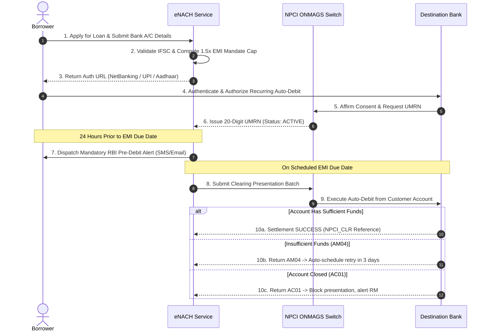

# 🏛️ eNACH & e-Mandate Automation Engine

<p align="center">
  
  
  
  
  
  
</p>

<p align="center">
  <strong>Enterprise NPCI eNACH & e-Mandate Recurring Repayment Microservice: Multi-Mode Customer Authentication, 20-digit UMRN Lifecycle, Mandatory RBI 24-Hour Pre-Debit Notifications, Clearing Presentation Batches, and Automated AM04 Bounce Recovery.</strong>
</p>

---

## 🌟 Why This Exists: The Problem in Digital Lending

In Indian digital lending, collecting monthly loan EMIs through manual UPI payment links or physical cheques leads to high default rates and severe operational drag:
1. **Paper Mandate Drag**: Physical NACH registration takes 10 to 15 business days to verify signatures with destination banks.
2. **Regulatory Strictness**: The **Reserve Bank of India (RBI)** strictly prohibits automatic debits without sending a pre-debit alert to the borrower at least **24 hours prior** to debit execution.
3. **High SaaS Overhead**: Third-party payment aggregators charge significant transaction markups and per-mandate maintenance fees.
4. **Bounce Representation Complexity**: When an account lacks balance (`AM04`), manual re-presentation fails to coordinate with salary re-credit windows.

**eNACH Mandate Service** provides an open, self-hosted, bank-grade clearing orchestration engine that fully automates the repayment lifecycle from initial customer consent to final clearing settlement.

---

## 🏛️ End-to-End Architecture & Clearing Flow

```
┌────────────────────────────────────────────────────────────────────────────────────────────────────────┐
│                                 eNACH & e-MANDATE REPAYMENT LIFECYCLE                                  │
└───────────────────────────────────────────────────┬────────────────────────────────────────────────────┘
                                                    │
        ┌───────────────────┬───────────────────────┼───────────────────────┬───────────────────┐
        ▼                   ▼                       ▼                       ▼                   ▼
┌───────────────┐   ┌───────────────┐       ┌───────────────┐       ┌───────────────┐   ┌───────────────┐
│ 1. Mandate    │   │ 2. Multi-Mode │       │ 3. UMRN       │       │ 4. RBI 24h    │   │ 5. Clearing   │
│ Initiation    │   │ Authentication│       │ Issuance      │       │ Pre-Debit     │   │ Presentation  │
├───────────────┤   ├───────────────┤       ├───────────────┤       ├───────────────┤   ├───────────────┤
│• IFSC check   │   │• Net Banking  │       │• 20-digit Ref │       │• SMS/Email    │   │• Daily Batch  │
│• A/C length   │   │• Debit Card   │       │• NPCI Central │       │• UMRN + Due Dt│   │• T+1 Settled  │
│• 1.5x EMI cap │   │• Aadhaar OTP  │       │• Status ACTIVE│       │• Audit Trail  │   │• AM04 Retry   │
│• Auth Portal  │   │• UPI AutoPay  │       │• Revocation   │       │• Block if missing│• AC01 Block  │
└───────────────┘   └───────────────┘       └───────────────┘       └───────────────┘   └───────────────┘
```



---

## ⚡ Key Capabilities

### 1. Multi-Mode Customer Authentication
Borrowers can authorize their recurring mandate through four distinct channels:
* **🌐 Net Banking**: Direct redirection to Destination Bank NetBanking portal.
* **💳 Debit Card + OTP**: Card credentials validated against 3D Secure bank OTP.
* **🆔 Aadhaar OTP**: UIDAI electronic biometric/OTP consent via NPCI ONMAGS.
* **📱 UPI AutoPay**: Instant mandate approval up to ₹15,000 (standard) or ₹1 Lakh+ for loan EMIs via UPI MPIN.

### 2. 20-Digit UMRN Lifecycle Management
* On successful customer approval, the engine generates or records the official **20-digit Unique Mandate Reference Number (UMRN)** conforming to NPCI format (e.g. `NPCI9002102938475610`).
* Maintains full audit trails for status changes: `CREATED` $\rightarrow$ `INVITATION_SENT` $\rightarrow$ `ACTIVE` $\rightarrow$ `CANCELLED`.

### 3. Strict RBI 24-Hour Pre-Debit Compliance
* Per RBI Circular *DPSS.CO.PD No.647/02.14.003/2019-20*, recurring payments cannot be debited without prior customer alert.
* The engine strictly **blocks clearing presentations** unless a compliant pre-debit alert (SMS/Email) containing the borrower name, loan account number, amount, due date, and UMRN was dispatched $\ge 24$ hours prior.

### 4. Daily Presentation Clearing Batches
* Aggregates multiple loans scheduled for the same due date into a single clearing batch.
* Summarizes total debits, success count, bounced count, and net settled amount.

### 5. NPCI Clearing Return Matrix & Recovery Engine

| Return Code | Description | Category | Retryable? | Automated Action |
| :--- | :--- | :--- | :---: | :--- |
| **`AM04`** | Insufficient Balance / Funds | Funds | ✅ Yes | Auto-schedule representation in 3 days on salary cycle. Max 3 retries. |
| **`AC01`** | Account Closed / Transferred | Account Status | ❌ No | Stop presentation immediately. Request new bank details from borrower. |
| **`AC04`** | Account Blocked / Frozen | Account Status | ❌ No | Escalate to risk team; issue notice under Section 25 PASA Act. |
| **`MD01`** | Mandate Revoked by Customer | Mandate Status | ❌ No | Customer revoked consent. Initiate default recovery workflow. |
| **`MD02`** | Stop Payment Instruction | Mandate Status | ❌ No | Customer placed stop-payment. Escalate to relationship manager. |
| **`MD07`** | Mandate End Date Expired | Mandate Status | ❌ No | Mandate expired. Request loan tenure renewal mandate. |
| **`AM05`** | Amount Exceeds Mandate Cap | Technical | ❌ No | Adjust presentation to match authorized max amount. |

---

## 📡 REST API Reference

### Mandate Registration & Lifecycle
* `POST /api/v1/mandates/initiate` — Register new mandate with $1.5\times$ EMI cap and bank validation.
* `GET /api/v1/mandates/:mandateId` — Fetch mandate details, audit trail, and UMRN status.
* `GET /api/v1/mandates` — List all registered mandates.
* `POST /api/v1/mandates/:mandateId/authenticate` — Approve customer mandate via NetBanking, Debit Card, Aadhaar, or UPI.
* `POST /api/v1/mandates/:mandateId/cancel` — Revoke mandate on NPCI switch.

### Regulatory Pre-Debit Alerts
* `POST /api/v1/notifications/send-pre-debit` — Dispatch mandatory RBI 24-hour pre-debit alert.

### Clearing Presentations
* `POST /api/v1/presentations/single` — Present single EMI installment to clearing switch.
* `POST /api/v1/presentations/batch` — Execute batch presentation run for loans due on a date.
* `POST /api/v1/presentations/:presentationId/retry` — Schedule automated retry for returned debits (`AM04`).

### Simulation & Local Development
* `GET /api/v1/mock-portal/:mandateId` — Interactive web portal to simulate borrower authentication.
* `GET /health` — Service health and operational status.

---

## 🚀 Quick Start Guide

### 1. Clone & Install
```bash
git clone https://github.com/saravanan-22/enach-mandate-service.git
cd enach-mandate-service
npm install
```

### 2. Run Comprehensive Test Suite
```bash
npm test
```
Executes all 15 unit tests covering Mandate Validation, Multi-Mode Auth, RBI Compliance, Batch Clearing, and Bounce Handlers:
```bash
✔ Mandate Engine - Registration, Validation & Multi-Mode Auth (7 passed)
✔ Presentation Engine - Clearing Batches, Settlement & Return Codes (5 passed)
✔ RBI & NPCI Regulatory Compliance Verification (3 passed)
```

### 3. Run End-to-End Demo
```bash
npm run demo
```
Runs a complete simulated lifecycle from mandate registration to UMRN generation, pre-debit notification, `AM04` bounce handling, and batch clearing.

### 4. Start Development Server
```bash
npm run dev
# Server running at http://localhost:4100/api/v1
# Mock Portal: http://localhost:4100/api/v1/mock-portal/:mandateId
```

---

## 🐳 Docker Deployment

Run the self-contained microservice container:
```bash
docker-compose up --build -d
```
Access the service at `http://localhost:4100`.

---

## 📄 License
Licensed under the [Apache-2.0 License](LICENSE). Built for enterprise fintech and digital lending infrastructure.
